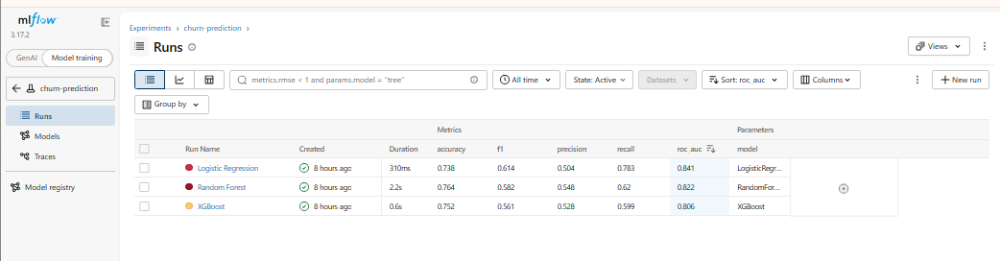
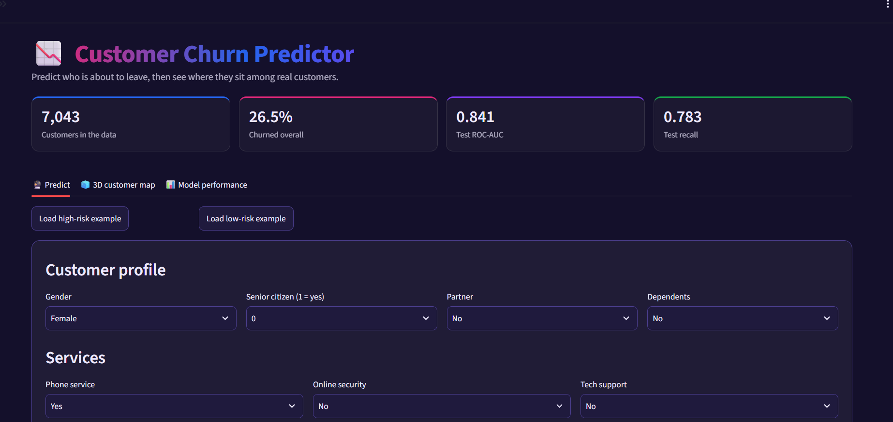
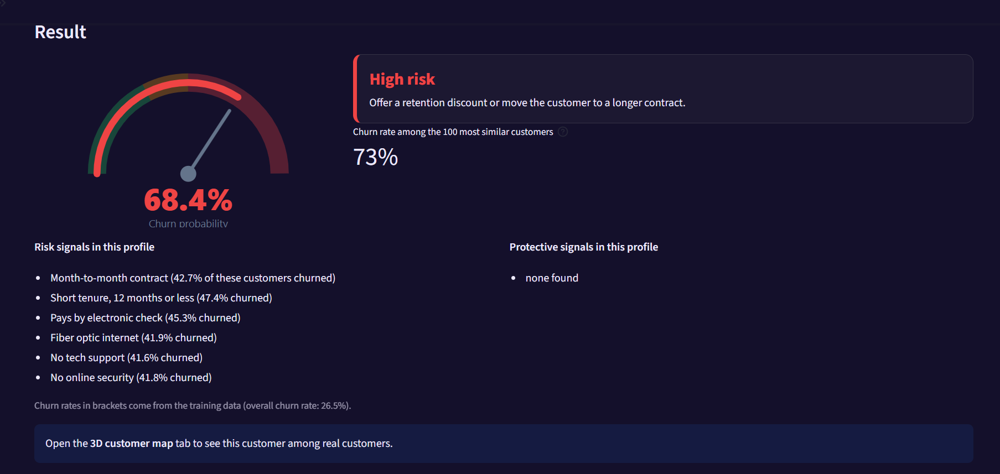
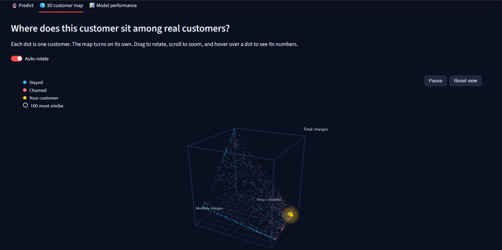
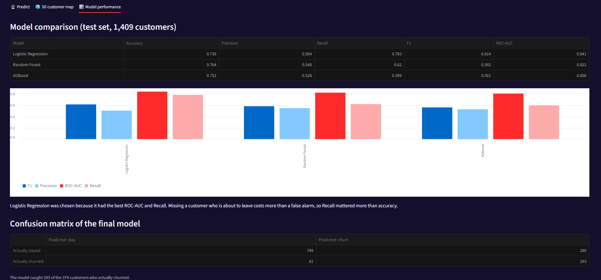
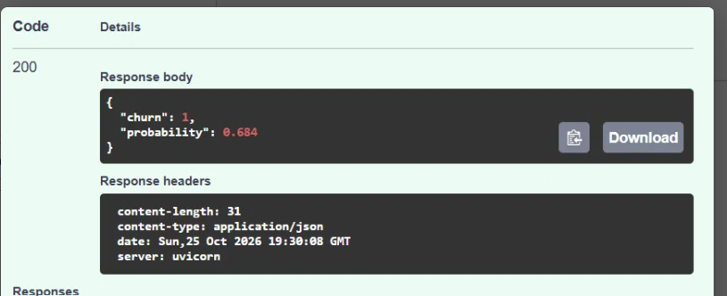

# Customer Churn Prediction Pipeline

An end-to-end machine learning project that predicts whether a telecom customer is likely to leave (churn). It covers data cleaning, preprocessing, model comparison, tuning, and serving the final model through a REST API.

## Dataset

[Telco Customer Churn](https://www.kaggle.com/datasets/blastchar/telco-customer-churn) dataset from Kaggle: 7,043 customers and 21 columns. About 27% of customers churned, so the classes are imbalanced.

## Project Structure

```
churn-ml-pipeline/
├── app/
│   ├── api.py              # FastAPI prediction API
│   └── streamlit_app.py    # Streamlit demo UI
├── data/raw/               # Raw dataset
├── notebooks/
│   └── 01_eda.ipynb        # EDA, preprocessing, model comparison, tuning
├── src/
│   ├── preprocess.py       # Data loading and preprocessing pipeline
│   ├── train.py            # Training, tuning, evaluation, model saving
│   └── predict.py          # Prediction for a new customer
├── config.yaml             # Paths and settings
└── requirements.txt
```

## What I Did

1. **EDA:** Found that month-to-month contracts, short tenure and higher monthly charges are linked to more churn.
2. **Cleaning:** Converted `TotalCharges` to numeric and handled 11 missing values.
3. **Preprocessing:** Built a scikit-learn `Pipeline` with `ColumnTransformer` (median imputation and scaling for numeric columns, one-hot encoding for categorical columns). The pipeline is fitted on training data only, which avoids data leakage.
4. **Class imbalance:** Used stratified splitting and class weights.
5. **Model comparison:** Logistic Regression, Random Forest and XGBoost.
6. **Tuning:** `GridSearchCV` with 5-fold cross-validation on the best model.
7. **Serving:** A FastAPI endpoint with input validation, plus a Streamlit demo.

## Results

Test set results (1,409 customers):

| Model | Accuracy | Precision | Recall | F1 | ROC-AUC |
|---|---|---|---|---|---|
| Logistic Regression | 0.738 | 0.504 | 0.783 | 0.614 | **0.841** |
| Random Forest | 0.764 | 0.548 | 0.620 | 0.582 | 0.822 |
| XGBoost | 0.752 | 0.528 | 0.599 | 0.561 | 0.806 |

**Final model:** Logistic Regression (tuned, `C=10`) with ROC-AUC 0.841 and Recall 0.783.

I chose Logistic Regression because missing a customer who is about to leave costs more than a false alarm, so Recall and ROC-AUC mattered more than accuracy. It is also simple to explain.

Confusion matrix of the final model:

|  | Predicted: stay | Predicted: churn |
|---|---|---|
| **Actually stayed** | 749 | 286 |
| **Actually churned** | 81 | 293 |

The model caught 293 of the 374 customers who actually churned.

## Experiment Tracking with MLflow

All three models were tracked with MLflow (parameters and metrics for each run), which made it easy to compare them side by side.



## How to Run

```bash
# 1. Install dependencies
python -m venv venv
venv\Scripts\activate          # Windows
pip install -r requirements.txt

# 2. Train the model (creates models/churn_model.joblib)
python -m src.train

# 3. Try a prediction
python -m src.predict

# 4. Start the API
uvicorn app.api:app --reload
# Open http://127.0.0.1:8000/docs

# 5. (Optional) Start the Streamlit demo
streamlit run app/streamlit_app.py
```

The trained model file is not stored in the repository, so run step 2 first.

## Live Demo App

**Try it live:** https://ml-pipeline-mqtg.onrender.com






## API Example

`POST /predict` returns the prediction and the churn probability for a customer.



Example response:

```json
{
  "churn": 1,
  "probability": 0.684
}
```

## Tech Stack

Python, pandas, NumPy, scikit-learn, XGBoost, Matplotlib, Seaborn, FastAPI, Pydantic, Streamlit, joblib, Git/GitHub.


## Future Work

- Containerize the API with Docker
- Deploy the API online